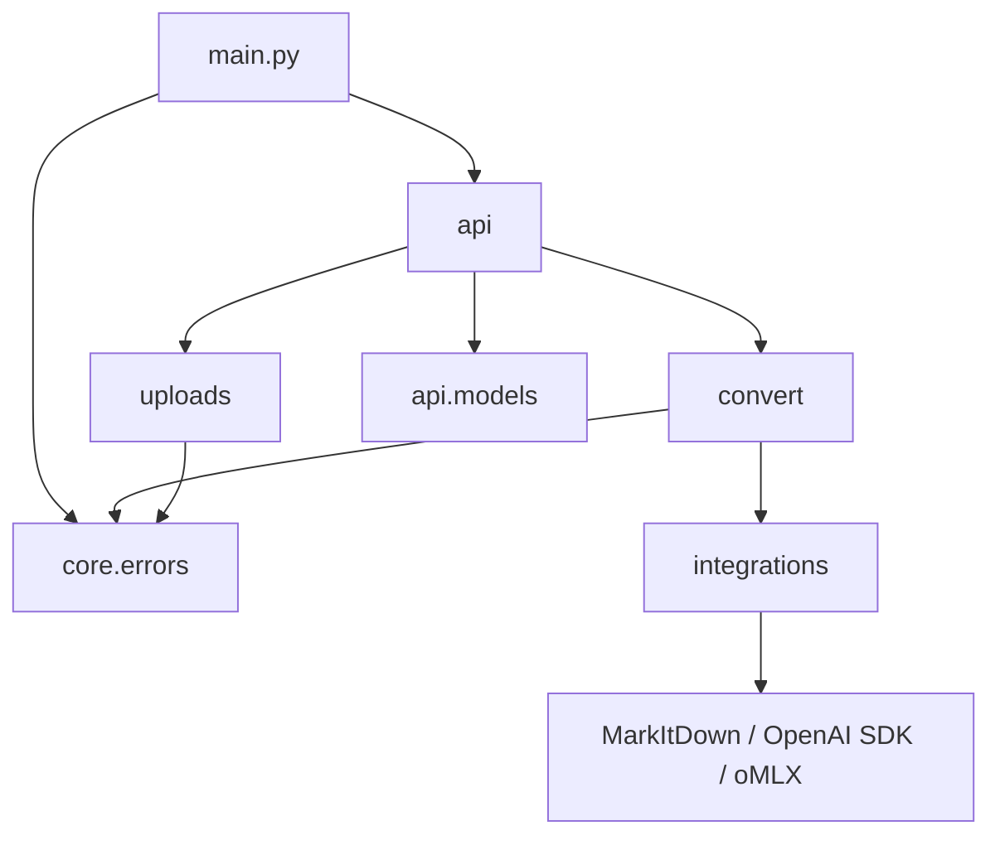
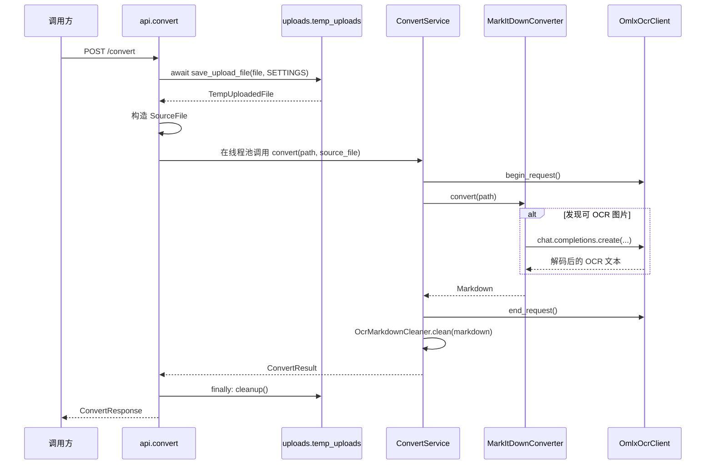

# to-markdown 代码参考

本文以当前仓库源码为准，说明服务入口、HTTP 合约、转换编排、第三方集成、资源生命周期和测试入口。设计层面的说明见[服务架构](architecture/service-architecture.md)和[分包架构](architecture/package-architecture.md)。

## 1. 代码范围与启动方式

```text
main.py
run_server.py
api/
  convert.py
  health.py
  models/
    convert.py
    health.py
core/
  config.py
  errors.py
  logging.py
convert/
  service.py
  types.py
  ocr_markdown_cleaner.py
integrations/
  markitdown.py
  omlx.py
uploads/
  temp_uploads.py
tests/
experiments/
```

项目根目录就是 Python import root。服务启动命令为：

```bash
.venv/bin/python run_server.py --reload
```

`run_server.py` 负责启动 Uvicorn；`uvicorn` 导入 `main:app`，`main.py` 负责创建 FastAPI 应用和注册路由。

## 2. 模块依赖方向



各层边界如下：

| 层 | 职责 | 不应依赖 |
| --- | --- | --- |
| `api` | 接收 HTTP 请求、处理上传、映射响应 | MarkItDown 和 OpenAI SDK 的细节 |
| `uploads` | 将上传流分块写入临时目录并清理 | 转换器和 OCR 逻辑 |
| `convert` | 编排一次文件转换和 OCR 输出清理 | FastAPI 请求对象和 HTTP 序列化 |
| `integrations` | 适配 MarkItDown、OpenAI-compatible oMLX | FastAPI 路由和 API 响应模型 |
| `core` | 配置、异常和基础日志入口 | 具体业务流程 |

## 3. HTTP 合约

### 3.1 路由

| 方法 | 路径 | 处理函数 | 作用 |
| --- | --- | --- | --- |
| `GET` | `/health` | `api.health.health()` | 检查 Web 进程是否存活。 |
| `GET` | `/health/omlx` | `api.health.omlx_health()` | 检查 oMLX TCP 端点是否可达。 |
| `POST` | `/convert` | `api.convert.convert_file()` | 上传文件并返回 Markdown。 |

没有根路径 `/`，也没有 `/hello/{name}`。

### 3.2 `POST /convert`

请求格式为 `multipart/form-data`，只接收一个必填字段：

| 字段 | 类型 | 说明 |
| --- | --- | --- |
| `file` | `UploadFile` | 文件名和 MIME 仅作为元信息，文件格式识别交给 MarkItDown。 |

转换服务固定启用 MarkItDown plugin。文件中没有可 OCR 图片时，plugin 不会访问 oMLX。

响应模型位于 [`api/models/convert.py`](../api/models/convert.py)：

| 字段 | 类型 | 说明 |
| --- | --- | --- |
| `markdown` | `string` | 转换后的 Markdown。 |
| `source_filename` | `string` | 原始上传文件名。 |
| `content_type` | `string \| null` | 客户端声明的 MIME type。 |
| `normalized` | `boolean` | OCR 清理器是否实际修改了输出。 |
| `warnings` | `string[]` | OCR 调用失败、模型输出退化等非致命提示。 |

### 3.3 统一错误

`main.py` 将 `AppError` 转换为：

```json
{
  "error": "错误码",
  "message": "异常文本"
}
```

| 异常 | 状态码 | 典型来源 |
| --- | --- | --- |
| `UploadTooLargeError` | `413` | 上传文件超过 `MAX_UPLOAD_MB`。 |
| `ConversionError` | `422` | MarkItDown 转换失败。 |
| `OmlxUnavailableError` | `503` | oMLX 健康检查失败；转换期间通常以 warning 返回。 |

## 4. 应用生命周期

### 4.1 `main.py`

`create_app()` 创建 FastAPI 实例，注册两个 router 和 `AppError` 异常处理器，并绑定 `lifespan`。

应用启动时：

1. 从进程级 `SETTINGS` 创建一个 `ConvertService`。
2. `ConvertService` 创建一个 `OmlxOcrClient`、一个 `MarkItDownConverter` 和一个 `OcrMarkdownCleaner`。
3. 服务对象保存到 `app.state.convert_service`，供每个请求复用。

应用关闭时调用 `ConvertService.close()`，释放 oMLX/OpenAI SDK 持有的 HTTP 资源。

### 4.2 `run_server.py`

`run_server.py` 只解析 `--host`、`--port`、`--reload` 和 `--log-level`，然后调用：

```python
uvicorn.run("main:app", ...)
```

它不创建第二套 FastAPI 应用，也不包含转换业务。

## 5. 请求生命周期



路由本身是异步函数，但 `ConvertService.convert()` 是同步函数，并通过 `run_in_threadpool()` 执行。因此请求仍然要等待转换完成，但不会直接阻塞 FastAPI 主事件循环；单 worker 服务可以同时接收多个请求，转换任务会竞争线程池和 oMLX 资源。

## 6. 核心数据类型与配置

### 6.1 `convert/types.py`

`SourceFile` 和 `ConvertResult` 是不依赖 FastAPI、Pydantic 或第三方转换器的 frozen dataclass。

```python
@dataclass(frozen=True)
class SourceFile:
    filename: str
    content_type: str | None
    size_bytes: int

@dataclass(frozen=True)
class ConvertResult:
    markdown: str
    source_filename: str
    content_type: str | None
    normalized: bool
    warnings: list[str]
```

### 6.2 `core/config.py`

模块级 `SETTINGS` 在进程导入时读取环境变量并生成不可变 `Settings` 快照。

| 配置 | 环境变量 | 默认值 |
| --- | --- | --- |
| oMLX 地址 | `OMLX_BASE_URL` | `http://127.0.0.1:8000/v1` |
| oMLX API key | `OMLX_API_KEY` | `20020228` |
| oMLX 模型 | `OMLX_MODEL` | `unlimited-ocr-mxfp8-mlx` |
| OCR prompt | `OMLX_OCR_PROMPT` | `Free OCR.` |
| 最大 OCR 输出 | `OMLX_OCR_MAX_TOKENS` | `4096` |
| OCR temperature | `OMLX_OCR_TEMPERATURE` | `0` |
| repetition penalty | `OMLX_OCR_REPETITION_PENALTY` | `1.1` |
| 临时目录 | `TEMP_DIR` | `<项目根目录>/.runtime/uploads` |
| 上传大小上限 | `MAX_UPLOAD_MB` | `100` |

### 6.3 `core/errors.py`

```text
Exception
└── AppError
    ├── ConversionError
    ├── OmlxUnavailableError
    └── UploadTooLargeError
```

## 7. 上传与转换层

### 7.1 `uploads/temp_uploads.py`

`save_upload_file()` 每次读取 1 MiB，边写入 `Settings.temp_dir` 边累计大小。超过上限时立即删除临时文件并抛出 `UploadTooLargeError`。

`TempUploadedFile.cleanup()` 使用 `unlink(missing_ok=True)`，由路由的 `finally` 调用，因此成功、失败和异常路径都会清理请求级临时文件。

### 7.2 `convert/service.py`

`ConvertService` 在初始化时装配并持有：

- `MarkItDownConverter`：固定启用 plugin。
- `OmlxOcrClient`：复用 OpenAI-compatible HTTP client。
- `OcrMarkdownCleaner`：固定执行 OCR 输出清理。

每次 `convert()` 只创建隔离的 `OmlxOcrCallState`，通过 `begin_request()` 和 `end_request()` 记录本次转换实际发生的 oMLX 调用，不共享 warning 状态。

转换步骤：

1. 创建请求级 OCR 调用状态。
2. 调用 MarkItDown 转换文件。
3. 收集本次 OCR 调用产生的 warning。
4. 调用 `OcrMarkdownCleaner.clean()`。
5. 返回 `ConvertResult`。

`close()` 只负责释放外部客户端资源，不删除上传文件；上传文件由 API 层负责清理。

### 7.3 `convert/ocr_markdown_cleaner.py`

清理器只处理已知 OCR 协议噪声：`[Image OCR]` 包装、`<|det|>` 检测标签、坐标和已知的模型前导字符。它保留识别文字和普通 Markdown，不调用模型，也不重写全文。

## 8. 第三方集成

### 8.1 `integrations/markitdown.py`

`MarkItDownConverter` 初始化：

```python
MarkItDown(
    enable_plugins=True,
    llm_client=...,
    llm_model=...,
    llm_prompt=...,
)
```

它只负责调用第三方 `convert()` 并将异常包装成 `ConversionError`。

### 8.2 `integrations/omlx.py`

`OmlxOcrClient` 在应用启动时创建一次：

1. 创建 `httpx.Client(trust_env=False)`。
2. 创建 `OpenAI(base_url=..., http_client=..., max_retries=0)`。
3. 暴露 MarkItDown 所需的 `chat.completions.create(...)` 结构。

共享的 HTTP client 不共享请求状态。每个转换通过 `ContextVar` 建立独立的 `OmlxOcrCallState`，因此并发请求的 warning 和请求计数不会互相污染。

`OmlxChatCompletions` 负责：

- 注入 `max_tokens`、`temperature` 和 `repetition_penalty` 默认值。
- 调用 OpenAI-compatible oMLX endpoint。
- 恢复 byte-level tokenizer 文本。
- 检测单字符循环并将退化文本丢弃。
- 将连接失败、截断和退化信息记录为本次调用的 warning。

`assert_omlx_reachable()` 只被 `/health/omlx` 使用，检查 TCP 可达性，不代表模型已经加载或推理一定成功。

`OmlxOcrClient.close()` 调用 OpenAI SDK 的关闭方法，释放底层 HTTP 资源。

## 9. 测试与排错资产

### 9.1 HTTP 测试入口

`tests/convert.py` 用于指定一个输入文件，通过真实 HTTP 服务转换并保存 Markdown。

`tests/convert_all.py` 递归遍历 `tests/test_files/input/`，串行调用 `/convert`，每次运行前清空 `tests/test_files/output/`。

### 9.2 自动化测试

- `tests/test_ocr_markdown_cleaner.py`：OCR 标记清理、普通 Markdown 保真和服务编排测试。
- `tests/test_omlx.py`：oMLX 请求参数、byte 解码、退化输出和截断 warning 测试。

### 9.3 独立实验

[`experiments/omlx_ocr_degeneration/`](../experiments/omlx_ocr_degeneration/) 是与正式服务隔离的模型退化复现实验。它不被服务代码 import，也不属于生产请求链路。

## 10. 维护规则

代码变更后应同步检查：

| 变更 | 需要更新 |
| --- | --- |
| 路由、请求或响应字段 | 本文第 3 节、`docs/architecture/service-architecture.md` |
| 服务初始化或资源释放 | 本文第 4、7、8 节和架构图 |
| OCR prompt、生成参数或清洗规则 | 本文第 6、7、8 节和相关测试 |
| 包结构或模块命名 | 本文第 1、2 节、`package-architecture.md` 和架构图 |

源码级核对可以使用：

```bash
rg -n "^(class |def |async def |@router\\.)" \
  main.py api core convert integrations uploads tests experiments
```
