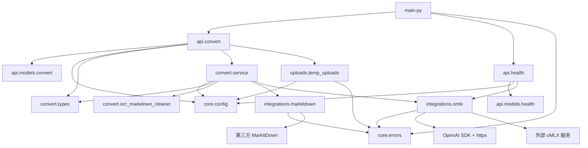
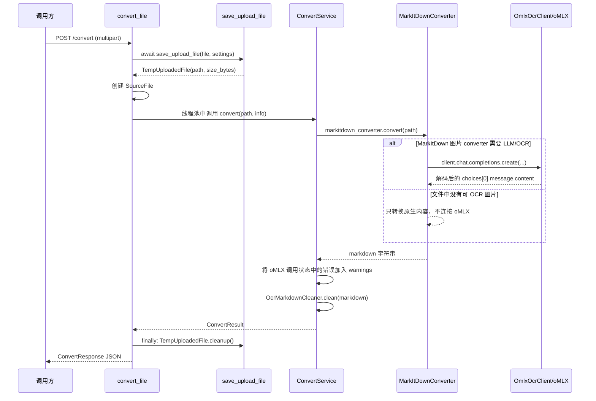

# to-markdown 完整代码参考

> 本文以仓库当前源码为准，覆盖运行时服务、共享类型、第三方集成、上传临时文件处理、独立 OCR demo 与现有 HTTP 测试样例。它描述的是“现在代码实际做什么”，而不是未来规划。架构层面的设计说明见 [服务架构](architecture/service-architecture.md) 和 [分包架构](architecture/package-architecture.md)。

## 1. 阅读范围与约定

### 1.1 已覆盖的源文件

| 范围 | 文件 | 作用 |
| --- | --- | --- |
| 服务入口 | [`main.py`](../main.py) | 创建 FastAPI 应用、注册路由、统一处理 `AppError`。 |
| HTTP 层 | [`api/convert.py`](../api/convert.py)、[`api/health.py`](../api/health.py)、[`api/models/`](../api/models/) | 接收请求、定义对外响应、调用服务层。 |
| 核心基础设施 | [`core/config.py`](../core/config.py)、[`core/errors.py`](../core/errors.py)、[`core/logging.py`](../core/logging.py) | 配置、统一异常、日志入口。 |
| Convert 功能 | [`convert/types.py`](../convert/types.py)、[`convert/service.py`](../convert/service.py)、[`convert/ocr_markdown_cleaner.py`](../convert/ocr_markdown_cleaner.py) | 转换编排、共享数据类型和 OCR 协议标记清理。 |
| 第三方集成 | [`integrations/markitdown.py`](../integrations/markitdown.py)、[`integrations/omlx.py`](../integrations/omlx.py) | MarkItDown 调用、oMLX OpenAI-compatible client、tokenizer byte 解码。 |
| 上传临时处理 | [`uploads/temp_uploads.py`](../uploads/temp_uploads.py) | 上传文件的分块保存、尺寸限制、清理。 |
| 独立排错 demo | [`demo/convert_file_to_markdown.py`](../demo/convert_file_to_markdown.py) | 不启动 Web 服务时验证 MarkItDown + oMLX OCR。 |
| 手工请求样例 | [`test_main.http`](../test_main.http) | 当前已过期的 HTTP Client 样例，详见第 11 节。 |

每个包还各有一个 `__init__.py`。这些文件目前只包含模块文档字符串，不导出符号、不执行初始化逻辑：

- [`api/__init__.py`](../api/__init__.py)：`"""HTTP API layer."""`
- [`integrations/__init__.py`](../integrations/__init__.py)：`"""第三方服务集成。"""`
- [`core/__init__.py`](../core/__init__.py)：`"""Application core utilities."""`
- [`convert/__init__.py`](../convert/__init__.py)：导出 Convert 功能的公开类型与服务。
- [`uploads/__init__.py`](../uploads/__init__.py)：`"""上传文件的临时处理。"""`

### 1.2 不在本文展开的代码

- `.venv/` 中的第三方库实现；本文只说明本项目如何调用它们。
- `MarkItDown`、OpenAI Python SDK、`httpx`、FastAPI/Starlette/Pydantic 的内部源码。
- Draw.io 图文件的 XML；它们是架构可视化资产，不是运行时代码。

### 1.3 Python 导入根与启动方式

项目根目录本身就是 Python import root，并没有再套一层 `to_markdown/` 包。因此源码使用：

```python
from api.convert import router
from convert import ConvertService
```

而不是 `from to_markdown.api ...`。在项目根目录启动：

```bash
.venv/bin/python run_server.py --reload
```

`uvicorn` 导入根目录的 [`main.py`](../main.py)，读取模块级变量 `app`。这会执行 `app = create_app()`。

## 2. 依赖、运行边界与模块图

### 2.1 第三方与标准库依赖

当前仓库中没有 `pyproject.toml`、`requirements.txt`、`Pipfile` 或 lock 文件，因此下面是从源码 import 反推的运行时依赖，**不是带版本约束的依赖清单**。

| 依赖 | 在哪里使用 | 当前职责 |
| --- | --- | --- |
| `fastapi` | `main.py`、`api/*`、`uploads/temp_uploads.py` | ASGI 应用、路由、表单上传、响应模型注册。 |
| `starlette.concurrency.run_in_threadpool` | `api/convert.py` | 将同步转换过程移出 async 事件循环。 |
| `pydantic` | `api/models/*.py` | API 响应字段声明、序列化和响应模型校验。 |
| `markitdown` | `integrations/markitdown.py`、demo | 文件类型路由和基础 Markdown 转换。 |
| `openai` | `integrations/omlx.py`、demo | OpenAI-compatible HTTP client；请求目标是本地 oMLX，不是 OpenAI 云端。 |
| `httpx` | `integrations/omlx.py`、demo | OpenAI SDK 使用的底层 HTTP client。 |
| `dataclasses` | `core/config.py`、`convert/types.py`、`uploads/temp_uploads.py` | 不可变配置、Convert 数据类型、临时文件对象。 |
| `pathlib`、`tempfile`、`socket`、`urllib.parse`、`types`、`os`、`functools`、`logging` | 多个模块 | 标准库路径、临时文件、TCP 检查、URL 解析、轻量响应对象、环境变量、缓存、日志。 |

### 2.2 模块依赖方向

下图展示本项目代码模块之间的真实 import/调用依赖。箭头方向是“调用方或使用方 -> 被依赖方”。



### 2.3 分层边界

| 层 | 可依赖的下游 | 不应知道的细节 | 当前实现 |
| --- | --- | --- | --- |
| `api` | `core`、`convert`、`uploads` | MarkItDown 构造参数、OpenAI SDK request 结构 | 路由只创建 Convert 数据类型并调用服务。 |
| `convert` | `core`、`integrations`、同包 types/OCR cleaner | FastAPI `Request`/`UploadFile`、HTTP JSON 序列化 | `ConvertService` 是同步核心入口。 |
| `integrations` | `core.errors`、第三方 SDK/服务 | FastAPI 细节和 API schema | 将外部异常/返回值适配为项目内部约定。 |
| `uploads` | `core` | MarkItDown/oMLX | 将上传流变成临时文件路径。 |
| `core` | 标准库 | 上层业务 | 设置、异常、日志基础入口。 |

## 3. 对外 HTTP 合约

### 3.1 实际注册的路由

| 方法与路径 | 注册位置 | 处理函数 | 成功响应 | 下游 |
| --- | --- | --- | --- | --- |
| `GET /health` | `health_router` 不带前缀注册 | `health()` | `HealthResponse` | 无外部检查。 |
| `GET /health/omlx` | 路由声明 `/health/omlx` | `omlx_health()` | `OmlxHealthResponse` | `get_settings()` -> `assert_omlx_reachable()`。 |
| `POST /convert` | 路由声明 `/convert` | `convert_file()` | `ConvertResponse` | 存储 -> 服务 -> MarkItDown/oMLX。 |

没有根路径 `GET /`，也没有 `/hello/{name}` 路由。

### 3.2 `POST /convert` 请求字段

请求 Content-Type 必须是 `multipart/form-data`。字段由 [`convert_file`](../api/convert.py#L16) 的 FastAPI 参数定义。

| 字段 | Python 类型 | FastAPI 声明 | 必填 | 默认值 | 去向 |
| --- | --- | --- | --- | --- |
| `file` | `UploadFile` | `File(...)` | 是 | 无 | `save_upload_file()`，然后构造成 `SourceFile`。 |

### 3.3 `ConvertResponse` 响应字段

由 [`api/models/convert.py`](../api/models/convert.py#L6) 的 Pydantic 模型定义；路由从 `ConvertResult` 显式映射字段。

| JSON 字段 | 类型 | 值来源 | 语义 |
| --- | --- | --- | --- |
| `markdown` | `string` | `ConvertResult.markdown` | MarkItDown 输出；偏内容和结构提取，不保证一定是美化后的 Markdown。 |
| `source_filename` | `string` | `SourceFile.filename` | 客户端原文件名；若 `UploadFile.filename` 为空则降级为临时文件名。 |
| `content_type` | `string \| null` | `UploadFile.content_type` | 客户端声明的 MIME type，未二次验证。 |
| `normalized` | `boolean` | OCR cleaner 返回值 | 是否清理了 OCR 协议标记。 |
| `warnings` | `string[]` | 服务层累积 | 包含 OCR 模型调用失败和 OCR cleaner 的非致命提示。 |

### 3.4 统一业务错误 JSON

[`main.py`](../main.py#L14) 为 `AppError` 注册异常处理器，结构固定为：

```json
{
  "error": "错误码",
  "message": "异常文本"
}
```

| 异常类 | 典型产生位置 | HTTP 状态 | `error` | 说明 |
| --- | --- | --- | --- | --- |
| `UploadTooLargeError` | `save_upload_file()` | `413` | `upload_too_large` | 上传累计字节数严格大于 `MAX_UPLOAD_MB`。 |
| `OmlxUnavailableError` | oMLX 健康检查或 oMLX wrapper | 健康检查为 `503`；转换期间由 plugin 捕获 | `omlx_unavailable` 或转换响应 warning | 见第 10.2 节。 |
| `ConversionError` | `MarkItDownConverter.convert()` | `422` | `conversion_failed` | 将任何 `MarkItDown.convert()` 期间的 `Exception` 包装。 |
| 非 `AppError` 异常 | 任意代码 | FastAPI 默认行为 | 无项目统一结构保证 | 例如配置中的非整数 `MAX_UPLOAD_MB`。 |

## 4. 完整请求生命周期

### 4.1 文件转换主链路



### 4.2 与数据对象的对应关系

| 阶段 | 输入类型 | 构造/返回类型 | 生产者 | 消费者 |
| --- | --- | --- | --- | --- |
| HTTP 上传 | `fastapi.UploadFile` | `TempUploadedFile` | `save_upload_file()` | `convert_file()`。 |
| 请求元信息 | `UploadFile` + `TempUploadedFile` | `SourceFile` | `convert_file()` | `ConvertService.convert()`。 |
| 转换主结果 | `Path` + `SourceFile` | `ConvertResult` | `ConvertService.convert()` | `convert_file()`。 |
| HTTP 响应 | `ConvertResult` | `ConvertResponse` | `convert_file()` | FastAPI/Pydantic 序列化。 |

### 4.3 线程模型

- `convert_file()` 是 `async def`，因此上传读取使用 `await upload_file.read(...)`。
- `ConvertService.convert()` 是普通同步函数，可能执行文件解析、阻塞式网络访问和第三方库逻辑。
- 路由使用 `starlette.concurrency.run_in_threadpool()` 执行该同步函数，防止其直接占用 FastAPI 主事件循环。
- `omlx_health()` 目前没有使用线程池，`assert_omlx_reachable()` 最多可阻塞该请求协程约 3 秒；它只是健康检查，不影响文件转换路由的线程池设计。

## 5. 服务入口与 HTTP 层

### 5.1 [`main.py`](../main.py)

#### 模块职责

应用装配点。它只负责创建 `FastAPI` 实例、挂载路由、安装统一业务异常处理器。它不读取配置、不保存文件、不直接调用 MarkItDown 或 oMLX。

#### `create_app() -> FastAPI`

来源：[`main.py:9`](../main.py#L9)。

| 项目 | 说明 |
| --- | --- |
| 上游调用者 | 模块级表达式 `app = create_app()`；也可被测试或其他 ASGI 启动方式显式调用。 |
| 输入 | 无参数。 |
| 输出 | 一个新的 `FastAPI` 实例。 |
| 内部下游 | `FastAPI(...)`、两个 `app.include_router(...)` 调用、内部函数 `handle_app_error()`。 |
| 配置结果 | `title="to-markdown"`，`version="0.1.0"`。 |

路由挂载细节：

1. `health_router` 注册 `/health` 和 `/health/omlx`。
2. `convert_router` 注册 `/convert`。
3. 任何继承 `AppError` 的异常会交给本函数中注册的 handler。

#### 内部函数 `handle_app_error(_, exc: AppError) -> JSONResponse`

来源：[`main.py:15`](../main.py#L15)。它定义在 `create_app()` 内部，没有模块级导出名。

| 项目 | 说明 |
| --- | --- |
| 上游调用者 | FastAPI 异常处理机制；只在路由处理过程抛出 `AppError` 或子类时调用。 |
| 参数 `_` | FastAPI 传入的 request 对象，但当前实现不使用，因此使用 `_` 忽略。 |
| 参数 `exc` | `AppError` 或其子类。读取 `exc.status_code`、`exc.code` 和 `str(exc)`。 |
| 输出 | `JSONResponse`，JSON 为 `{ "error": exc.code, "message": str(exc) }`。 |
| 下游 | `JSONResponse(...)`。 |
| 未做的事 | 不记录日志、不附带 traceback、不为非 `AppError` 异常统一格式化。 |

#### 模块级 `app`

来源：[`main.py:27`](../main.py#L27)。这是 Uvicorn 导入目标 `main:app`。模块 import 时即创建应用并完成路由/handler 注册。

### 5.2 [`api/models/`](../api/models/)

#### 模块职责

按功能定义 HTTP 响应模型。当前请求只由 FastAPI 的 `UploadFile` 参数表达。

#### `ConvertResponse(BaseModel)`

来源：[`api/models/convert.py:6`](../api/models/convert.py#L6)。

| 字段 | 注解 | 默认值 | 上游 | 下游 |
| --- | --- | --- | --- | --- |
| `markdown` | `str` | 无 | `ConvertResult.markdown` | JSON `markdown`。 |
| `source_filename` | `str` | 无 | `ConvertResult.source_filename` | JSON `source_filename`。 |
| `content_type` | `str \| None` | `None` | `ConvertResult.content_type` | JSON `content_type`。 |
| `normalized` | `bool` | 无 | `ConvertResult.normalized` | JSON `normalized`。 |
| `warnings` | `list[str]` | `Field(default_factory=list)` | `ConvertResult.warnings` | JSON `warnings`。 |

`default_factory=list` 的意义是每个 `ConvertResponse` 实例都有独立的空列表，避免可变列表默认值被多个实例共享。

#### `HealthResponse(BaseModel)`

来源：[`api/models/health.py:6`](../api/models/health.py#L6)。只有 `status: str`；由 `health()` 构造 `HealthResponse(status="ok")`。

#### `OmlxHealthResponse(BaseModel)`

来源：[`api/models/health.py:10`](../api/models/health.py#L10)。

| 字段 | 类型 | 来源 |
| --- | --- | --- |
| `status` | `str` | 固定 `"ok"`。 |
| `base_url` | `str` | `Settings.omlx_base_url`。 |
| `model` | `str` | `Settings.omlx_model`。 |

### 5.3 [`api/convert.py`](../api/convert.py)

#### 模块职责与上下游

该模块是 HTTP 到领域服务的适配边界：

```text
FastAPI multipart 请求
  -> UploadFile
  -> TempUploadedFile + SourceFile
  -> ConvertService.convert(...)
  -> ConvertResult
  -> ConvertResponse JSON
```

它的上游是 FastAPI 路由分发和 [`main.py`](../main.py) 的 `convert_router` 注册；下游是 `core.config`、`uploads.temp_uploads`、`convert` 与 `api.models.convert`。

#### 模块级 `router = APIRouter(tags=["convert"])`

来源：[`convert.py:11`](../api/convert.py#L11)。由 `main.py` 直接注册。`tags=["convert"]` 只影响 FastAPI OpenAPI 文档分组，不改变 URL 或业务行为。

#### `convert_file(...) -> ConvertResponse`

来源：[`convert.py:15`](../api/convert.py#L15)。该函数由 `@router.post("/convert", response_model=ConvertResponse)` 注册，最终路径为 `POST /convert`。

**签名和参数**：

```python
async def convert_file(
    file: UploadFile = File(...),
) -> ConvertResponse
```

**逐步调用关系**：

| 顺序 | 当前函数动作 | 调用的下游 | 输入 | 输出/后续用途 |
| --- | --- | --- | --- | --- |
| 1 | 获取进程级配置 | `get_settings()` | 无 | `Settings`。 |
| 2 | 异步落盘上传内容 | `await save_upload_file(file, settings)` | `UploadFile`、`Settings` | `TempUploadedFile(path, size_bytes)`。 |
| 3 | 构造原始文件元信息 | `SourceFile(...)` | 原文件名、MIME、临时文件大小 | 给服务层判断文件类别和生成结果元数据。 |
| 4 | 创建服务对象 | `ConvertService.from_settings(settings)` | `Settings` | 一个请求使用一个 `ConvertService` 实例。 |
| 5 | 执行同步转换 | `await run_in_threadpool(service.convert, ...)` | 临时路径、`SourceFile` | `ConvertResult`。 |
| 6 | 无条件清理 | `temp_file.cleanup()` | 临时文件对象 | 删除请求临时文件。 |
| 7 | 映射 HTTP 响应 | `ConvertResponse(...)` | `ConvertResult` 各字段 | FastAPI JSON 响应。 |

**`try/finally` 边界**：

- `temp_file` 成功创建后，构造领域模型、服务转换或响应映射前的异常都会进入 `finally`，调用 `cleanup()`。
- `save_upload_file()` 在 `try` 之前执行。如果它自身抛异常，路由不会进入这个 `finally`；上传过大这一条分支会在 helper 内部主动 unlink 临时文件。
- `cleanup()` 使用 `missing_ok=True`，因此文件已被删除时不会引发二次异常。

**异常上游/下游**：

- `UploadTooLargeError`、服务层直接抛出的 `OmlxUnavailableError`、`ConversionError` 都向上传到 `main.handle_app_error()`。
- 未被项目异常系统包装的异常交给 FastAPI 默认异常处理。

### 5.4 [`api/health.py`](../api/health.py)

#### 模块级 `router = APIRouter(tags=["health"])`

来源：[`health.py:9`](../api/health.py#L9)。由 `main.py` 无 prefix 注册。

#### `health() -> HealthResponse`

来源：[`health.py:13`](../api/health.py#L13)。

| 项目 | 说明 |
| --- | --- |
| 最终路由 | `GET /health`。 |
| 上游 | 负载均衡器、容器探针、人工调用。 |
| 下游 | 无。 |
| 返回 | `HealthResponse(status="ok")`。 |
| 边界 | 只代表 Web 进程能够处理请求，**不检查** oMLX、模型可用性、临时目录写权限或 MarkItDown。 |

#### `omlx_health() -> OmlxHealthResponse`

来源：[`health.py:20`](../api/health.py#L20)。

| 项目 | 说明 |
| --- | --- |
| 最终路由 | `GET /health/omlx`。 |
| 上游 | 运维检查、人工排障。 |
| 下游调用 | `get_settings()` -> `assert_omlx_reachable(settings.omlx_base_url)`。 |
| 返回 | TCP 连接成功后返回 `status`、`base_url`、`model`。 |
| 失败 | URL 非法或 TCP 无法连接时抛 `OmlxUnavailableError`，经 `main.handle_app_error()` 返回 `503`。 |
| 边界 | TCP 可达不等于 `/chat/completions` 可用，也不等于模型已加载、模型名存在或 OCR 请求可成功。 |

## 6. 领域模型与核心基础设施

### 6.1 [`convert/types.py`](../convert/types.py)

#### 模块职责

Convert 数据类型不依赖 FastAPI、Pydantic、MarkItDown 或 OpenAI SDK。所有显式定义的 dataclass 都使用 `@dataclass(frozen=True)`：初始化后不能给字段重新赋值；dataclasses 仍会生成常规 `__init__`、`__repr__` 和值比较 `__eq__`。

#### `SourceFile`

来源：[`convert/types.py:6`](../convert/types.py#L6)。

| 字段 | 类型 | 构造者 | 消费者 | 说明 |
| --- | --- | --- | --- | --- |
| `filename` | `str` | `convert_file()` | `ConvertService.convert()`、最终 `ConvertResult` | 优先原始上传文件名。 |
| `content_type` | `str \| None` | `convert_file()` | 最终结果 | 来自客户端 MIME 声明。 |
| `size_bytes` | `int` | `save_upload_file()` 返回的字节数 | 当前服务层不使用 | 保留给审计、限制、结果扩展。 |

#### `ConvertResult`

来源：[`convert/types.py:23`](../convert/types.py#L23)。

| 字段 | 类型 | 生产者 | 消费者 |
| --- | --- | --- | --- |
| `markdown` | `str` | `ConvertService.convert()` | `ConvertResponse.markdown`。 |
| `source_filename` | `str` | 由 `SourceFile.filename` 复制 | `ConvertResponse.source_filename`。 |
| `content_type` | `str \| None` | 由 `SourceFile.content_type` 复制 | `ConvertResponse.content_type`。 |
| `normalized` | `bool` | OCR cleaner 返回值 | `ConvertResponse.normalized`。 |
| `warnings` | `list[str]` | 服务层本地列表 | `ConvertResponse.warnings`。 |

`warnings` 虽然是 frozen dataclass 的字段，但列表内容本身仍可变；当前代码只在构造前通过 `warnings.extend(...)` 修改它。

### 6.2 [`core/config.py`](../core/config.py)

#### `Settings`

来源：[`config.py:9`](../core/config.py#L9)。不可变的进程配置快照。

| 字段 | 类型 | 环境变量 | 默认值 | 消费者 |
| --- | --- | --- | --- | --- |
| `omlx_base_url` | `str` | `OMLX_BASE_URL` | `http://127.0.0.1:8000/v1` | `OmlxOcrClient`、`assert_omlx_reachable()`、oMLX health 响应。 |
| `omlx_api_key` | `str` | `OMLX_API_KEY` | `20020228` | `OmlxOcrClient`。 |
| `omlx_model` | `str` | `OMLX_MODEL` | `unlimited-ocr-mxfp8-mlx` | `MarkItDownConverter` 的 `llm_model`、health 响应。 |
| `omlx_ocr_prompt` | `str` | `OMLX_OCR_PROMPT` | `Free OCR.` | `MarkItDownConverter` 的 `llm_prompt`。 |
| `omlx_ocr_max_tokens` | `int` | `OMLX_OCR_MAX_TOKENS` | `4096` | oMLX OCR 请求的输出上限。 |
| `omlx_ocr_temperature` | `float` | `OMLX_OCR_TEMPERATURE` | `0` | oMLX OCR 请求的采样温度。 |
| `omlx_ocr_repetition_penalty` | `float` | `OMLX_OCR_REPETITION_PENALTY` | `1.1` | 防止 OCR 模型陷入单 token 循环。 |
| `temp_dir` | `Path` | `TEMP_DIR` | `<项目根目录>/.runtime/uploads` | `save_upload_file()`。 |
| `max_upload_mb` | `int` | `MAX_UPLOAD_MB` | `100` | `save_upload_file()`。 |

#### `get_settings() -> Settings`

来源：[`config.py:18`](../core/config.py#L18)。

| 项目 | 说明 |
| --- | --- |
| 装饰器 | `@lru_cache`，无参数调用结果会按 Python 进程缓存。 |
| 上游调用者 | `convert_file()`、`omlx_health()`；未来任意模块也可调用。 |
| 下游 | `os.getenv()`、`Path(...)`、`Settings(...)`。 |
| 返回 | 首次调用时读取环境变量并构造 `Settings`，后续调用返回同一缓存结果。 |
| 重要行为 | 进程启动后再修改环境变量不会自动反映到已缓存的设置；测试或运行时重载需要显式 `get_settings.cache_clear()` 才会重新读取。 |
| 失败 | 整数或浮点配置无法解析时抛 `ValueError`；这不是 `AppError`。 |

### 6.3 [`core/errors.py`](../core/errors.py)

#### 异常继承结构

```text
Exception
└── AppError
    ├── ConversionError
    ├── OmlxUnavailableError
    └── UploadTooLargeError
```

每个类没有自定义 `__init__`，异常消息来自构造时传入的字符串，`str(exc)` 返回该消息。

| 类型 | 来源 | `code` | `status_code` | 主要上游 | 主要下游 |
| --- | --- | --- | --- | --- | --- |
| `AppError(Exception)` | [`errors.py:1`](../core/errors.py#L1) | `app_error` | `500` | 抽象统一父类 | `main.handle_app_error()`。 |
| `ConversionError(AppError)` | [`errors.py:6`](../core/errors.py#L6) | `conversion_failed` | `422` | `MarkItDownConverter.convert()` | FastAPI 统一 JSON 错误。 |
| `OmlxUnavailableError(AppError)` | [`errors.py:11`](../core/errors.py#L11) | `omlx_unavailable` | `503` | oMLX TCP/HTTP wrapper | FastAPI 统一 JSON 错误，或在 MarkItDown 内部被包装。 |
| `UploadTooLargeError(AppError)` | [`errors.py:16`](../core/errors.py#L16) | `upload_too_large` | `413` | `save_upload_file()` | FastAPI 统一 JSON 错误。 |

### 6.4 [`core/logging.py`](../core/logging.py)

#### `get_logger(name: str) -> logging.Logger`

来源：[`logging.py:4`](../core/logging.py#L4)。直接返回标准库 `logging.getLogger(name)`。

| 项目 | 说明 |
| --- | --- |
| 上游调用者 | 当前仓库没有调用点。 |
| 下游 | Python 标准库 `logging.getLogger`。 |
| 行为 | 只获取 logger，不配置 handler、级别、格式化器或结构化字段。 |
| 扩展位置 | 后续统一日志配置可以保留此函数作为获取入口。 |

## 7. 文件保存与业务编排

### 7.1 [`uploads/temp_uploads.py`](../uploads/temp_uploads.py)

#### `TempUploadedFile`

来源：[`temp_uploads.py:12`](../uploads/temp_uploads.py#L12)。请求级临时文件引用，不可变。

| 字段/方法 | 类型或签名 | 上游 | 下游 | 行为 |
| --- | --- | --- | --- | --- |
| `path` | `Path` | `NamedTemporaryFile` 路径 | `ConvertService.convert()`、`cleanup()` | 实际落盘文件。 |
| `size_bytes` | `int` | 分块累计写入量 | `SourceFile.size_bytes` | 不含额外元数据。 |
| `cleanup()` | `() -> None` | `convert_file()` 的 `finally` | `Path.unlink(missing_ok=True)` | 删除文件；不存在时忽略。 |

#### `save_upload_file(upload_file: UploadFile, settings: Settings) -> TempUploadedFile`

来源：[`temp_uploads.py:20`](../uploads/temp_uploads.py#L20)。异步读取 FastAPI 上传流并存入临时目录。

| 项目 | 说明 |
| --- | --- |
| 上游调用者 | `api.convert.convert_file()`。 |
| 输入 `upload_file` | FastAPI `UploadFile`，使用其 `filename` 取扩展名、异步 `read()` 取内容。 |
| 输入 `settings` | `Settings.temp_dir` 和 `Settings.max_upload_mb`。 |
| 返回 | 成功时返回 `TempUploadedFile(path, size_bytes)`。 |
| 下游 | `Path.mkdir()`、`NamedTemporaryFile(delete=False, suffix=..., dir=...)`、`UploadFile.read(1024 * 1024)`、`TempUploadedFile(...)`。 |

**详细算法**：

1. `settings.temp_dir.mkdir(parents=True, exist_ok=True)`：确保目录存在。
2. `Path(upload_file.filename or "").suffix`：只保留最后一个扩展名作为临时文件后缀；例如 `archive.tar.gz` 会得到 `.gz`。
3. `max_bytes = max_upload_mb * 1024 * 1024`：将 MB 转为字节。
4. `NamedTemporaryFile(delete=False, ...)`：临时文件关闭后仍保留，因为 MarkItDown 需要按路径再次打开。
5. 每次 `await upload_file.read(1024 * 1024)` 最多读 1 MiB。
6. 每个 chunk 先累加 `written`，若严格大于上限，立即 `unlink` 并抛 `UploadTooLargeError`；等于上限允许写入。
7. 未超过上限时写入 chunk，文件关闭后返回路径和总大小。

**异常和资源行为**：

- 过大文件会由本函数自行删除已创建的临时路径，然后抛出 `UploadTooLargeError`。
- 当前函数不调用 `await upload_file.close()`；上传对象的关闭由 FastAPI/请求生命周期处理。
- 除“超限”分支外，普通磁盘 I/O 异常未转换成 `AppError`。

### 7.2 [`convert/ocr_markdown_cleaner.py`](../convert/ocr_markdown_cleaner.py)

#### `OcrMarkdownCleaner`

来源：[`ocr_markdown_cleaner.py:6`](../convert/ocr_markdown_cleaner.py#L6)。负责保守清理 MarkItDown OCR plugin 输出的协议噪声。

#### `clean(self, markdown: str) -> tuple[str, bool, list[str]]`

来源：[`ocr_markdown_cleaner.py:17`](../convert/ocr_markdown_cleaner.py#L17)。

| 项目 | 说明 |
| --- | --- |
| 上游调用者 | `ConvertService.convert()`，每次文件转换后固定调用。 |
| 输入 | MarkItDown 输出的 `markdown` 字符串。 |
| 返回第 1 项 | 移除 OCR 边界标记、已知 `det` 标签与坐标后的 Markdown。 |
| 返回第 2 项 | 只有实际更改文本时为 `True`。 |
| 返回第 3 项 | 当前为空警告列表。 |
| 当前边界 | `title` 转为一级标题，`text` 和有内容的 `image` 区段保留；不调用 LLM，不全局改写普通 Markdown。 |

### 7.3 [`convert/service.py`](../convert/service.py)

#### 模块职责

这是同步业务编排核心：它不接触 HTTP request/response，也不保存上传流。输入是已经落盘的 `Path` 和 `SourceFile`，输出是 `ConvertResult`。

#### `ConvertService.__init__(self, settings, ocr_cleaner=None)`

来源：[`service.py:18`](../convert/service.py#L18)。

| 参数 | 类型 | 行为 |
| --- | --- | --- |
| `settings` | `Settings` | 保存到 `self._settings`，供 oMLX URL/key/model 读取。 |
| `ocr_cleaner` | `OcrMarkdownCleaner \| None` | 非空时注入；为空时创建默认 `OcrMarkdownCleaner()`。 |

上游可以用于测试时注入替代 OCR cleaner。当前生产路径总是经 `from_settings()` 使用默认 OCR cleaner。

#### `ConvertService.from_settings(cls, settings) -> ConvertService`

来源：[`service.py:27`](../convert/service.py#L27)。

| 项目 | 说明 |
| --- | --- |
| 上游调用者 | `convert_file()`。 |
| 输入 | 已缓存的 `Settings`。 |
| 下游 | `cls(settings=settings)`，即调用构造函数。 |
| 输出 | 一个新 `ConvertService`。 |
| 作用 | 当前只是命名构造器；未来可以集中装配更多依赖。 |

#### `ConvertService.convert(self, file_path, source_file) -> ConvertResult`

来源：[`service.py:31`](../convert/service.py#L31)。这是真正由 HTTP 路由放入线程池的同步函数。

| 参数 | 类型 | 来自哪里 | 用于哪里 |
| --- | --- | --- | --- |
| `file_path` | `Path` | `TempUploadedFile.path` | MarkItDown `convert`。 |
| `source_file` | `SourceFile` | `convert_file()` | 返回原始元数据。 |

**函数内部的准确顺序**：

1. 创建局部 `warnings: list[str] = []`。
2. 调用 `_create_markitdown_converter()`，得到转换器和本次请求的 `OmlxOcrClient`；构造 OCR client 不会访问网络。
3. `markitdown_converter.convert(file_path)` 得到 Markdown 字符串；只有 plugin 发现可 OCR 图片时才调用 oMLX。
4. 将 `OmlxOcrClient.call_state.errors` 累积到响应 warnings；没有发生模型调用时该列表为空。
5. 无条件调用 OCR cleaner 并累积警告。
6. 构造并返回 `ConvertResult`。

#### `_create_markitdown_converter(self) -> tuple[MarkItDownConverter, OmlxOcrClient]`

来源：[`service.py:62`](../convert/service.py#L62)。私有装配函数。

| 返回值 | 参数传递 | 下游行为 |
| --- | --- | --- |
| `(MarkItDownConverter(...), OmlxOcrClient)` | `llm_client=OmlxOcrClient`、model、prompt | MarkItDown 固定加载已安装 plugin，发现图片时才调用 oMLX。 |

`OmlxOcrClient` 在这个函数内创建，base URL 和 API key 来自 `Settings`。OCR client 同时返回给 `convert()`，用于在转换后读取本次请求的调用次数和错误；每次转换单独创建，不跨请求共享状态。

## 8. 第三方集成

### 8.1 [`integrations/markitdown.py`](../integrations/markitdown.py)

#### 模块职责

隔离第三方 `markitdown.MarkItDown` 的构造和转换调用，并将其转换阶段的异常统一为项目的 `ConversionError`。

#### `MarkItDownConverter.__init__(self, llm_client=None, llm_model=None, llm_prompt=None)`

来源：[`markitdown.py:10`](../integrations/markitdown.py#L10)。

| 参数 | 类型 | 上游传入者 | 传给第三方的位置 |
| --- | --- | --- | --- |
| `llm_client` | `Any \| None` | `ConvertService._create_markitdown_converter()` | `MarkItDown(llm_client=...)`。 |
| `llm_model` | `str \| None` | 同上 | `MarkItDown(llm_model=...)`。 |
| `llm_prompt` | `str \| None` | 同上 | `MarkItDown(llm_prompt=...)`。 |

实现固定传递 `enable_plugins=True`；LLM 参数只有非 `None` 时才加入 `kwargs`，最后执行 `MarkItDown(**kwargs)`。

#### `MarkItDownConverter.convert(self, file_path: Path) -> str`

来源：[`markitdown.py:26`](../integrations/markitdown.py#L26)。

| 项目 | 说明 |
| --- | --- |
| 上游调用者 | `ConvertService.convert()`。 |
| 输入 | 临时文件 `Path`。 |
| 下游 | `self._markitdown.convert(str(file_path))`。路径被转为字符串，因为第三方接口在当前代码中按字符串调用。 |
| 成功返回 | `result.markdown`，即第三方结果对象的 Markdown 字段。 |
| 异常行为 | 捕获 `Exception`（不是 `BaseException`），将其变成 `ConversionError("MarkItDown conversion failed: {exc}")`，并保留原异常为异常链 `__cause__`。 |

**重要异常边界**：由于 `except Exception` 包围整个 `MarkItDown.convert()`，由 MarkItDown 内部调用 oMLX 时产生的 `OmlxUnavailableError` 也通常会在这里被转成 `ConversionError`。这会影响最终 HTTP 状态，详见第 10.2 节。

### 8.2 [`integrations/omlx.py`](../integrations/omlx.py)

#### 模块职责

该模块提供两类能力：

1. 供健康检查端点使用的 oMLX TCP 可达性检查；
2. 满足 MarkItDown 所需形状的最小 OpenAI client，记录实际调用状态，并在 chat completion 返回后修复 byte-level tokenizer 乱码。

它不加载 MLX/VLM 模型权重。模型权重、Metal/MLX 调度和服务进程生命周期属于独立 oMLX 服务。

#### `bytes_to_unicode() -> dict[int, str]`

来源：[`omlx.py:11`](../integrations/omlx.py#L11)。

| 项目 | 说明 |
| --- | --- |
| 上游调用者 | 模块 import 时用于构造 `BYTE_DECODER`。当前没有其他直接调用点。 |
| 输入 | 无。 |
| 输出 | `dict[int, str]`，语义为原始 byte 值 `0..255` -> 可显示 Unicode 字符。 |
| 算法 | 先保留 `!` 到 `~`、`¡` 到 `¬`、`®` 到 `ÿ`，再为未覆盖的 byte 依序分配 Unicode code point `256+`。 |
| 用途 | 复现 GPT-2/byte-level BPE 风格的可见字符映射，为反向解码准备。 |

#### 模块级 `BYTE_DECODER`

来源：[`omlx.py:29`](../integrations/omlx.py#L29)。

```python
BYTE_DECODER = {visible_character: original_byte}
```

它通过反转 `bytes_to_unicode()` 的结果构建一次，后续被 `decode_tokenizer_bytes()` 查表。模块 import 时立即求值。

#### `decode_tokenizer_bytes(text: str) -> str`

来源：[`omlx.py:32`](../integrations/omlx.py#L32)。

| 项目 | 说明 |
| --- | --- |
| 上游调用者 | `OmlxChatCompletions.create()`，每个 response choice 的 `message.content` 都会经过它。 |
| 输入 | oMLX/OpenAI-compatible 响应中的文本内容。 |
| 下游 | `BYTE_DECODER.get()`、`bytearray`、`bytes.decode("utf-8", errors="replace")`。 |
| 输出 | 尝试恢复为正常 UTF-8 文本的字符串。 |

**逐字符行为**：

1. 若字符在 `BYTE_DECODER` 中，追加其代表的一个原始 byte。
2. 若字符不在表中，直接将该字符 UTF-8 编码后的 byte 序列追加。
3. 所有 byte 最后按照 UTF-8 解码；不合法序列用替换字符 `�` 代替，不会抛 `UnicodeDecodeError`。

它解决的是 tokenizer 显示层没有还原的情况，例如 `ä»Ģä¹Ī` 这类可见 byte 映射，不是读取本地文件时的编码设置问题。

#### `assert_omlx_reachable(base_url: str) -> None`

来源：[`omlx.py:45`](../integrations/omlx.py#L45)。

| 项目 | 说明 |
| --- | --- |
| 上游调用者 | `omlx_health()`；文件转换不再调用该函数。 |
| 输入 | 例如 `http://127.0.0.1:8000/v1`。 |
| 下游 | `urlparse()`、`socket.create_connection((host, port), timeout=3)`。 |
| 成功返回 | `None`。TCP socket 建连成功即返回。 |
| URL 端口规则 | URL 显式端口优先；没有端口时，`https` 用 `443`，其他 scheme 用 `80`。 |
| 已包装失败 | 无 hostname 或 socket 抛 `OSError` 时，抛 `OmlxUnavailableError`。 |
| 不验证的内容 | `/v1/chat/completions` path、HTTP 状态、鉴权、模型名、模型是否已加载、图像 data URI 是否被服务支持。 |

`urlparse(base_url).port` 对格式非法的端口文本可能抛 `ValueError`，当前实现没有将其包装为 `OmlxUnavailableError`。

#### `OmlxChatCompletions`

来源：[`omlx.py:71`](../integrations/omlx.py#L71)。这是一个小型 wrapper，用来伪造 MarkItDown 所期待的 `client.chat.completions.create(...)` 访问路径。

##### `__init__(self, openai_completions, omlx_base_url: str, ocr_call_state: OmlxOcrCallState)`

来源：[`omlx.py:72`](../integrations/omlx.py#L72)。

| 字段 | 值 | 来源 | 用途 |
| --- | --- | --- | --- |
| `self._openai_completions` | OpenAI SDK 的 chat completions resource | `OmlxOcrClient` | 真正发 HTTP 请求。 |
| `self._omlx_base_url` | oMLX base URL | `OmlxOcrClient` | 组装可读的错误信息。 |
| `self._ocr_call_state` | 请求级 `OmlxOcrCallState` | `OmlxOcrClient` | 记录真实请求次数与去重后的错误。 |

##### `create(self, *args, **kwargs) -> SimpleNamespace`

来源：[`omlx.py:76`](../integrations/omlx.py#L76)。

| 项目 | 说明 |
| --- | --- |
| 上游调用者 | MarkItDown 图片 converter 通过 `llm_client.chat.completions.create(model=..., messages=...)` 调用。 |
| 输入 | 透传的 positional/keyword 参数；文档中实际关注 `model` 和 OpenAI vision 形状 `messages`。 |
| 下游 | `self._openai_completions.create(*args, **kwargs)`、`summarize_messages()`、`decode_tokenizer_bytes()`。 |
| 成功输出 | `SimpleNamespace(choices=[SimpleNamespace(message=..., finish_reason=...), ...])`。保留 MarkItDown 所需的文本和结束原因。 |
| HTTP 目标 | OpenAI SDK 会以 `base_url` 为基础向 `.../chat/completions` 发起请求。 |

**错误处理**：每次 `create()` 先增加请求计数。连接失败和其他请求异常都会写入 `OmlxOcrCallState.errors` 后重新抛出；当前 OCR plugin 会捕获单张图片的异常，因此 `ConvertService` 在转换完成后读取状态并将错误作为 warning 返回。重复错误会去重。

**请求参数**：MarkItDown 未指定生成参数时，wrapper 补充配置中的 `max_tokens`、`temperature` 和 oMLX `repetition_penalty`。显式请求参数优先。

**结果适配**：遍历 `response.choices`，读取并解码文本。明显的单字符循环会被丢弃并记录 warning；达到 token 上限的非退化输出会保留，同时记录可能不完整的 warning。

#### `summarize_messages(messages: list[dict]) -> str`

来源：[`omlx.py:101`](../integrations/omlx.py#L101)。

| 项目 | 说明 |
| --- | --- |
| 上游调用者 | `OmlxChatCompletions.create()` 的 `APIConnectionError` 错误信息构造。 |
| 输入 | OpenAI chat messages 列表。 |
| 输出 | 逗号分隔摘要，例如 `text(16 chars), image_url(144546 chars)`。 |
| 目的 | 不在错误文本中输出整张图的 base64，只保留文本/URL 字符数量。 |

**消息分支**：

- `message["content"]` 是字符串：追加 `text(N chars)`。
- 否则将其视为 iterable；每个 item 的 `type="text"` 统计 `text` 长度，`type="image_url"` 统计 `image_url.url` 长度，其它类型记录类型名。
- 函数假设非字符串 `content` 的元素支持 `.get()`；不符合 OpenAI vision 约定的结构可能在此抛异常。

#### `OmlxOcrClient`

来源：[`omlx.py:123`](../integrations/omlx.py#L123)。

##### `__init__(self, base_url: str, api_key: str, max_tokens: int, temperature: float, repetition_penalty: float)`

来源：[`omlx.py:124`](../integrations/omlx.py#L124)。

| 步骤 | 代码行为 | 下游 |
| --- | --- | --- |
| 1 | 创建 `httpx.Client(trust_env=False)` | 忽略 `HTTP_PROXY` 等环境代理设置，直接使用 base URL。 |
| 2 | 创建 `OpenAI(base_url=..., api_key=..., http_client=..., max_retries=0)` | OpenAI SDK 只作协议 client，不代表调用 OpenAI 云端。`max_retries=0` 禁用 SDK 自动重试。 |
| 3 | 构造 `self.chat = SimpleNamespace(completions=OmlxChatCompletions(...))` | 暴露 MarkItDown 所需的访问路径，并注入 OCR 生成参数。 |

**对上游的接口契约**：`MarkItDownConverter` 把本对象作为 `llm_client` 传给 `MarkItDown`。MarkItDown 不需要知道它是 oMLX client，只要能调用：

```python
client.chat.completions.create(model=..., messages=...)
```

**当前生命周期细节**：`ConvertService._create_markitdown_converter()` 在每次转换中创建一个 `OmlxOcrClient`。类中没有 `close()`，也没有显式关闭内部 `httpx.Client` 的代码；该 OCR client 的可达引用随着本次转换器/MarkItDown 转换结束而消失，但没有显式资源关闭钩子。

## 9. 独立排错 Demo

### 9.1 [`demo/convert_file_to_markdown.py`](../demo/convert_file_to_markdown.py) 的定位

该文件不是 Web 服务运行时依赖。`main.py`、`api`、`convert` 都不会 import 它。它用于单进程验证：

```text
本地 PNG 文件
  -> MarkItDown
  -> 自定义 OpenAI-compatible oMLX client
  -> oMLX OCR/VLM
  -> result.markdown
  -> 本地 .md 文件
```

它与 `integrations/omlx.py` 共享同一类核心思路，但错误类型和日志文本更偏人工排错。由于文件**没有** `if __name__ == "__main__":` 保护，直接执行或被 import 时都会从第 215 行开始进行 TCP 检查、调用模型、写文件并打印输出。

### 9.2 模块级常量

| 常量 | 来源 | 值/默认值 | 下游 |
| --- | --- | --- | --- |
| `PROJECT_ROOT` | [`demo:13`](../demo/convert_file_to_markdown.py#L13) | `Path(__file__).resolve().parents[1]` | 输入/输出文件路径。 |
| `OMLX_BASE_URL` | [`demo:19`](../demo/convert_file_to_markdown.py#L19) | 环境变量或 `http://127.0.0.1:8000/v1` | TCP 检查、运行时的 `OmlxOcrClient`。 |
| `OMLX_API_KEY` | [`demo:23`](../demo/convert_file_to_markdown.py#L23) | 环境变量或 `20020228` | 运行时的 `OmlxOcrClient`。 |
| `OMLX_MODEL` | [`demo:27`](../demo/convert_file_to_markdown.py#L27) | 环境变量或 `unlimited-ocr-mxfp8-mlx` | `MarkItDown(llm_model=...)`。 |
| `INPUT_FILE` | [`demo:31`](../demo/convert_file_to_markdown.py#L31) | `tests/test_files/input/test_img.png` | `md.convert(...)`。 |
| `OUTPUT_FILE` | [`demo:32`](../demo/convert_file_to_markdown.py#L32) | `tests/test_files/output/legacy/test_img_omlx.md` | `mkdir()`、`write_text()`。 |

### 9.3 `bytes_to_unicode()`、`BYTE_DECODER`、`decode_tokenizer_bytes()`

来源分别为 [`demo:35`](../demo/convert_file_to_markdown.py#L35)、[`demo:60`](../demo/convert_file_to_markdown.py#L60)、[`demo:63`](../demo/convert_file_to_markdown.py#L63)。

它们的算法、输入输出和调用关系与服务运行时的 [`integrations/omlx.py`](../integrations/omlx.py) 对应定义相同：

| Demo 定义 | 服务等价定义 | 作用 |
| --- | --- | --- |
| `bytes_to_unicode()` | `integrations.omlx.bytes_to_unicode()` | 建立 byte -> 可显示字符映射。 |
| `BYTE_DECODER` | `integrations.omlx.BYTE_DECODER` | 反向查表。 |
| `decode_tokenizer_bytes(text)` | `integrations.omlx.decode_tokenizer_bytes(text)` | 恢复中文等 UTF-8 byte-level 输出。 |

差异不在算法，而在注释粒度：demo 用更多行内注释解释乱码成因，运行时代码更紧凑。

### 9.4 `assert_omlx_reachable(base_url)`

来源：[`demo:82`](../demo/convert_file_to_markdown.py#L82)。

| 项目 | Demo 行为 | 运行时转换器行为 |
| --- | --- | --- |
| TCP 检查算法 | `urlparse` + `socket.create_connection(..., timeout=3)` | 相同。 |
| URL 无 hostname | `raise SystemExit(...)` | `raise OmlxUnavailableError(...)`。 |
| socket 失败 | `SystemExit`，包含端点、启动提示、示例环境变量命令和原始 socket 错误 | `OmlxUnavailableError`，包含端点摘要。 |
| 上游 | demo 模块顶层第 215 行 | 服务层 `ConvertService.convert()` 与 health route。 |

Demo 选择 `SystemExit` 是为了命令行快速停止并给人看清楚的排错信息；服务运行时需要继续由 FastAPI 生成结构化 HTTP 错误，所以使用 `AppError` 子类。

### 9.5 `DecodingChatCompletions`

来源：[`demo:121`](../demo/convert_file_to_markdown.py#L121)。

#### `__init__(self, completions, base_url)`

来源：[`demo:128`](../demo/convert_file_to_markdown.py#L128)。保存 OpenAI SDK completions resource 和显示用 base URL；上游为 demo 的 `OmlxClient.__init__()`。

#### `create(self, *args, **kwargs) -> SimpleNamespace`

来源：[`demo:132`](../demo/convert_file_to_markdown.py#L132)。

| 项目 | Demo 行为 | 与服务运行时的差异 |
| --- | --- | --- |
| 正常请求 | 透传给 OpenAI SDK completions | 相同。 |
| `APIConnectionError` | 抛 `RuntimeError` | 服务版抛 `OmlxUnavailableError`。 |
| 错误信息 | 除 endpoint/model/messages 摘要外，还包含服务端 log 排查提示和原始 SDK 错误 | 服务版错误更适合 API 返回。 |
| 正常结果 | 逐 choice 执行 byte 解码，返回最小 `choices[*].message.content` 结构 | 相同。 |

### 9.6 `summarize_messages(messages)`

来源：[`demo:170`](../demo/convert_file_to_markdown.py#L170)。调用方式与算法和服务版相同：在连接错误时只记录文本长度、图片 data URI 长度与未知类型名，不打印完整 base64。

### 9.7 `OmlxClient.__init__(self, base_url, api_key)`

来源：[`demo:199`](../demo/convert_file_to_markdown.py#L199)。

它创建：

1. `httpx.Client(trust_env=False)`；
2. `OpenAI(base_url=..., api_key=..., http_client=..., max_retries=0)`；
3. `self.chat.completions = DecodingChatCompletions(...)`。

它是给 `MarkItDown(llm_client=client)` 使用的最小 client 形状，而不是独立的 HTTP server。

### 9.8 Demo 顶层执行序列

来源：[`demo:215`](../demo/convert_file_to_markdown.py#L215)。

| 顺序 | 顶层语句 | 作用 |
| --- | --- | --- |
| 1 | `assert_omlx_reachable(OMLX_BASE_URL)` | 在文件转换前检查 oMLX TCP 端口。 |
| 2 | `client = OmlxClient(...)` | 创建本地 OpenAI-compatible wrapper。 |
| 3 | `md = MarkItDown(...)` | 注入 client、模型名与 `llm_prompt="Free OCR."`。 |
| 4 | `result = md.convert(str(INPUT_FILE))` | 触发 MarkItDown 的文件类型路由与可能的 OCR 请求。 |
| 5 | `markdown = result.markdown` | 读取统一结果字段。 |
| 6 | `OUTPUT_FILE.parent.mkdir(...)` | 确保输出目录存在。 |
| 7 | `OUTPUT_FILE.write_text(markdown, encoding="utf-8")` | 用 UTF-8 写 Markdown 文件。 |
| 8 | `print(...)` | 输出 Markdown 和写入路径。 |

关于 prompt：demo 使用 `"Free OCR."`，没有手写 `<image>`。MarkItDown 向 oMLX 发送 OpenAI vision 风格 `image_url` 时，应由服务端插入图像 token；额外手写 `<image>` 可能造成图像 token 与实际图片数量不匹配。

## 10. 端到端调用与异常传播细节

### 10.1 函数级调用关系清单

| 上游函数/代码 | 下游函数/代码 | 传递的数据 | 下游返回或副作用 |
| --- | --- | --- | --- |
| `app = create_app()` | `create_app()` | 无 | 创建 app、注册路由/handler。 |
| `create_app()` | `app.include_router(health_router)` | `APIRouter` | 注册 `/health`、`/health/omlx`。 |
| `create_app()` | `app.include_router(convert_router)` | `APIRouter` | 注册 `/convert`。 |
| FastAPI | `convert_file()` | `UploadFile` | `ConvertResponse` 或异常。 |
| `convert_file()` | `get_settings()` | 无 | 缓存的 `Settings`。 |
| `convert_file()` | `save_upload_file()` | `UploadFile`、`Settings` | `TempUploadedFile`。 |
| `convert_file()` | `SourceFile(...)` | 文件名/MIME/字节数 | 领域元数据。 |
| `convert_file()` | `ConvertService.from_settings()` | `Settings` | 服务对象。 |
| `convert_file()` | `run_in_threadpool(service.convert, ...)` | `Path`、`SourceFile` | `ConvertResult`。 |
| `convert_file()` | `TempUploadedFile.cleanup()` | 临时路径 | 删除文件。 |
| FastAPI | `health()` | 无 | `HealthResponse("ok")`。 |
| FastAPI | `omlx_health()` | 无 | TCP 检查后 `OmlxHealthResponse`。 |
| `omlx_health()` | `assert_omlx_reachable()` | `Settings.omlx_base_url` | `None` 或 `OmlxUnavailableError`。 |
| `ConvertService.convert()` | `_create_markitdown_converter()` | 无 | `(MarkItDownConverter, OmlxOcrClient)`。 |
| `ConvertService.convert()` | `MarkItDownConverter.convert()` | 临时文件路径 | `str markdown`。 |
| `ConvertService.convert()` | `OcrMarkdownCleaner.clean()` | Markdown | `(markdown, normalized, warnings)`。 |
| `_create_markitdown_converter()` | `OmlxOcrClient(...)` | base URL、API key、生成参数 | 最小 OpenAI-compatible client。 |
| `_create_markitdown_converter()` | `MarkItDownConverter(...)` | client/model/prompt 或空参数 | 外部转换器。 |
| `MarkItDownConverter.__init__()` | `MarkItDown(**kwargs)` | LLM 相关可选参数 | 第三方 converter 实例。 |
| `MarkItDownConverter.convert()` | `MarkItDown.convert(str(path))` | 本地路径字符串 | 第三方转换结果。 |
| MarkItDown 图片 converter | `OmlxOcrClient.chat.completions.create()` | `model`、OpenAI vision messages | 轻量 choices response。 |
| `OmlxChatCompletions.create()` | OpenAI SDK `create()` | model、messages、受控生成参数 | oMLX HTTP 请求。 |
| `OmlxChatCompletions.create()` | `decode_tokenizer_bytes()` | choice 文本 | 修复后的文本。 |
| `decode_tokenizer_bytes()` | `BYTE_DECODER` | 每个字符 | 原始 bytes -> UTF-8 文本。 |

### 10.2 异常在当前代码中的实际路径

| 触发条件 | 最先抛出的异常 | 中间处理 | 客户端最终常见结果 |
| --- | --- | --- | --- |
| 上传累计大小超过 `MAX_UPLOAD_MB` | `UploadTooLargeError` | 直接到 `main.handle_app_error()` | `413 upload_too_large`。 |
| plugin 已启用但文件没有图片 | 不产生异常，也不发起 oMLX 请求 | MarkItDown 只转换原生内容 | `200`，无 oMLX warning。 |
| plugin 发现图片，但 oMLX 请求失败 | wrapper 记录错误并重新抛出 | OCR plugin 捕获单图异常；服务层转换后读取状态 | `200`，保留普通转换结果并返回 warning。 |
| `GET /health/omlx` 时 TCP 不可连 | `OmlxUnavailableError` | 直接到 `main` handler | `503 omlx_unavailable`。 |
| MarkItDown 文件格式/转换失败 | 第三方异常 | `MarkItDownConverter.convert()` -> `ConversionError` | `422 conversion_failed`。 |
| 输出含已知 OCR 协议标记 | OCR cleaner 确定性清理 | 保留识别文字 | `200`，`normalized=true`。 |
| OCR 模型陷入明显的单字符循环 | wrapper 丢弃退化 OCR 文本 | 记录 warning，避免污染 Markdown | `200`，保留其它可提取内容。 |
| 非法 `MAX_UPLOAD_MB` | `ValueError` | 当前未包装 | FastAPI 默认 500 行为。 |

健康检查失败仍返回 `503`；文件转换中的 OCR 是增强能力，单张图片调用失败不会丢弃已经提取出的原生内容，而是通过 warnings 暴露。

### 10.3 文件和模型资源生命周期

| 资源 | 创建位置 | 使用位置 | 清理/释放位置 | 当前行为 |
| --- | --- | --- | --- | --- |
| 上传临时文件 | `save_upload_file()` | 服务层/MarkItDown | `convert_file()` 的 `finally` | 请求结束前删除。 |
| `Settings` | 首次 `get_settings()` | 多个路由与服务 | 进程结束或手动 `cache_clear()` | 缓存于进程。 |
| `ConvertService` | 每个转换请求 | 本次同步转换 | 函数引用离开作用域 | 无长生命周期状态。 |
| `OmlxOcrClient` | 每次转换 | 传给 MarkItDown | 无显式 `close()` | 构造时不联网，由本次对象引用生命周期承担。 |
| oMLX 模型权重 | 外部 oMLX 进程 | chat completions | oMLX 服务自身停止/卸载策略 | 不在 Python Web 服务进程内。 |

## 11. 测试资产、文档资产与当前缺口

### 11.1 [`test_main.http`](../test_main.http)

该文件不是 Python 模块，也没有类型或函数定义。它包含两个 HTTP Client 请求：

```http
GET http://127.0.0.1:8000/
GET http://127.0.0.1:8000/hello/User
```

它们均不是当前 `main.py` 注册的路由，因此是**过期样例**，不能作为当前服务验证依据。当前正确接口见第 3.1 节：

```http
GET http://127.0.0.1:8000/health

###

GET http://127.0.0.1:8000/health/omlx
```

文件转换请求应使用 multipart form，例如：

```bash
curl -X POST http://127.0.0.1:8001/convert \
  -F "file=@tests/test_files/input/test_img.png"
```

上面的命令是文档中的正确调用示例，不会修改现有 `test_main.http`。

### 11.2 当前自动化测试状态

当前有 OCR Markdown cleaner 的轻量自动化测试，其他链路仍以手工验证为主：

- `demo/convert_file_to_markdown.py`：直接验证 MarkItDown + oMLX OCR。
- `tests/convert.py`：通过实际 HTTP 服务执行固定启用 plugin 的手工转换。
- `tests/test_ocr_markdown_cleaner.py`：验证 OCR 标记清理和普通 Markdown 保真。
- `tests/test_files/`：人工输入及持久化输出目录。
- `test_main.http`：但其端点已经过期。

请求成功、OCR 失败映射、文件大小限制和临时文件清理仍没有自动化回归测试。

### 11.3 与现有架构文档的关系

| 文档 | 回答的问题 | 与本文的边界 |
| --- | --- | --- |
| [service-architecture.md](architecture/service-architecture.md) | 为什么使用 FastAPI、MarkItDown、oMLX；服务层级与 v1 范围。 | 侧重设计和产品边界。 |
| [package-architecture.md](architecture/package-architecture.md) | 包为什么这样划分，未来异步化如何复用 service。 | 侧重包职责。 |
| 本文 | 每个文件、类型、函数如何调用，数据和异常如何沿链路流动。 | 作为源码级参考。 |
| `to-markdown-architecture.drawio` | 可视化技术栈、请求流、代码地图。 | 作为图形导航，具体语义以源码和本文为准。 |

## 12. 维护此文档的规则

后续改动代码时，应同步检查以下对应章节：

| 代码变化 | 必须更新的本文部分 |
| --- | --- |
| 新增或修改路由、表单字段、响应字段 | 第 3、5 节。 |
| 新增领域对象或修改 dataclass 字段 | 第 4.2、6.1 节。 |
| 修改 OCR 判断、MarkItDown 参数、OCR cleaner 行为 | 第 7.3、8、10 节。 |
| 修改 oMLX URL、模型名、认证、重试或 client 生命周期 | 第 6.2、8.2、10.3 节。 |
| 新增对象存储、队列、数据库、文本 LLM | 第 2.3、4、10.3、11.3 节，并补充新模块的逐符号说明。 |
| 修正/替换 `test_main.http` 或增加 pytest | 第 11 节。 |

建议每次提交前做一次源码与文档的双向核对：

```bash
rg -n "^(class |def |async def |@router\\.|@app\\.)" \
  main.py api core domain convert integrations uploads demo
```

若输出中出现本文未列出的定义，或本文描述的符号已经不存在，就需要同步更新本文件。
