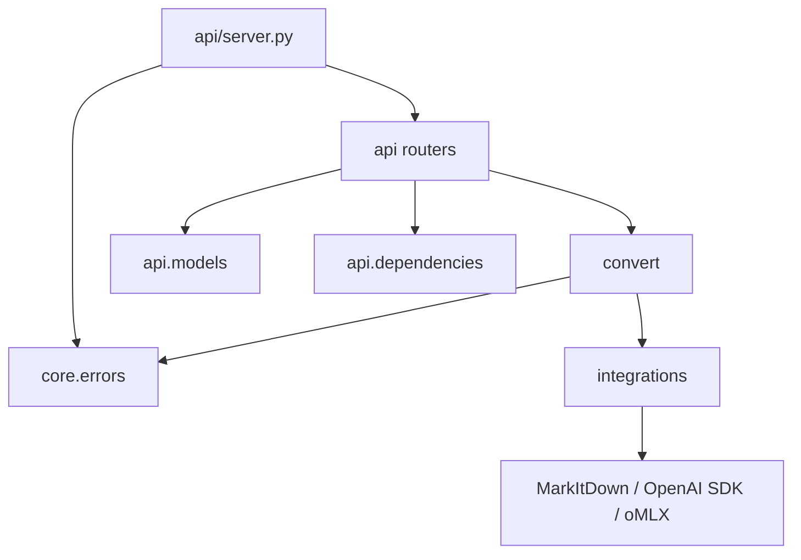
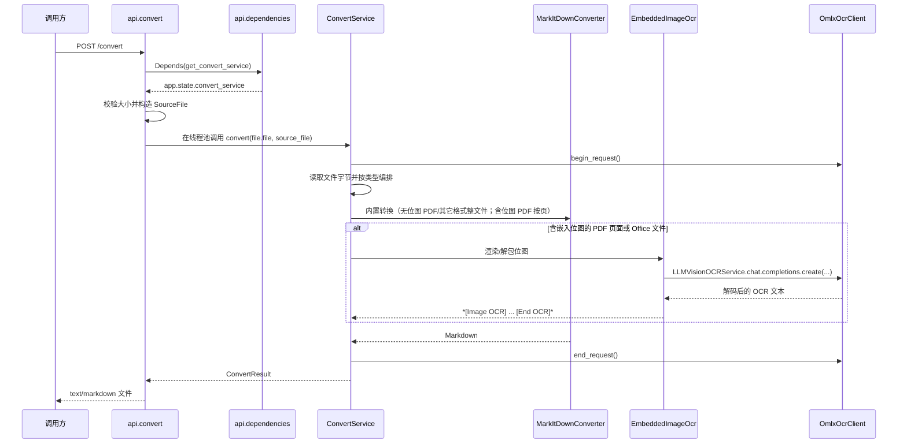

# to-markdown 代码参考

本文以当前仓库源码为准，说明服务入口、HTTP 合约、转换编排、第三方集成、资源生命周期和测试入口。设计层面的说明见[服务架构](architecture/service-architecture.md)和[分包架构](architecture/package-architecture.md)。

## 1. 代码范围与启动方式

```text
api/
  server.py
  convert.py
  health.py
  dependencies.py
  models/
    health.py
configuration/
  config.py
core/
  errors.py
  logging.py
convert/
  service.py
  types.py
integrations/
  markitdown.py
  embedded_image_ocr.py
  omlx.py
tests/
experiments/
```

项目根目录就是 Python import root。服务启动命令为：

```bash
uv sync
uv run python -m api.server --reload
```

`api/server.py` 同时负责创建 FastAPI 应用、注册路由和启动 Uvicorn；服务以 `python -m api.server` 运行，热重载时由 Uvicorn 导入 `api.server:app`。

## 2. 模块依赖方向



各层边界如下：

| 层 | 职责 | 不应依赖 |
| --- | --- | --- |
| `api` | 接收 multipart 文件流、通过 `Depends` 获取服务、返回 Markdown 文件 | MarkItDown 和 OpenAI SDK 的细节 |
| `convert` | 编排一次文件转换和 OCR 输出清理 | FastAPI 请求对象和 HTTP 序列化 |
| `integrations` | 适配 MarkItDown、OpenAI-compatible oMLX | FastAPI 路由和 API 响应模型 |
| `core` | 配置、异常和基础日志入口 | 具体业务流程 |

## 3. HTTP 合约

### 3.1 路由

| 方法 | 路径 | 处理函数 | 作用 |
| --- | --- | --- | --- |
| `GET` | `/health` | `api.health.health()` | 检查 Web 进程是否存活。 |
| `GET` | `/health/omlx` | `api.health.omlx_health()` | 检查 oMLX TCP 端点是否可达。 |
| `POST` | `/convert` | `api.convert.convert_file()` | 上传一个文件并返回单个 Markdown 文件。 |

没有根路径 `/`，也没有 `/hello/{name}`。

### 3.2 `POST /convert`

请求格式为 `multipart/form-data`，只接收一个必填字段：

| 字段 | 类型 | 说明 |
| --- | --- | --- |
| `file` | `UploadFile` | 文件名和 MIME 仅作为元信息，文件格式识别交给 MarkItDown。 |

转换服务只启用 MarkItDown 内置转换器；无嵌入位图的 PDF 整篇单遍转换，含位图或无法解析时才逐页转换并带 `## Page N` 分页；
嵌入位图通过 markitdown-ocr 的 `LLMVisionOCRService` 按需访问本地
unlimited-ocr。文件中没有嵌入位图时不会访问 oMLX。

成功响应直接使用 `text/markdown; charset=utf-8`，响应体就是 Markdown 内容；
`Content-Disposition` 提供 `.md` 下载文件名。服务不返回 JSON envelope，也不
返回 object key、业务状态或存储路径。

服务不提供 `/convert/object`，不读取 MinIO、文件系统业务路径或远程 URL。调用
方负责取得文件内容，并保存返回的 Markdown。

### 3.3 统一错误

`api/server.py` 将 `AppError` 转换为：

```json
{
  "error": "错误码",
  "message": "异常文本"
}
```

| 异常 | 状态码 | 典型来源 |
| --- | --- | --- |
| `UploadTooLargeError` | `413` | 上传文件超过 `MAX_UPLOAD_MB`。 |
| `ConversionError` | `422` | MarkItDown 转换失败。 |
| `OmlxUnavailableError` | `503` | oMLX 健康检查失败；转换期间通常以 warning 返回。 |

## 4. 应用生命周期

### 4.1 `api/server.py`

`create_app()` 创建 FastAPI 实例，注册两个 router 和 `AppError` 异常处理器，并绑定 `lifespan`。

应用启动时：

1. 从缓存的 `get_conversion_settings()` 创建一个 `ConvertService`。
2. `ConvertService` 创建一个 `OmlxOcrClient`、一个 `MarkItDownConverter` 和一个 `EmbeddedImageOcr`。
3. 服务对象保存到 `app.state.convert_service`，由 `api.dependencies.get_convert_service()` 通过 `Depends` 提供给每个请求复用。

应用关闭时调用 `ConvertService.close()`，释放 oMLX/OpenAI SDK 持有的 HTTP 资源。

### 4.2 Uvicorn 启动

`api.server.main()` 先调用 `get_http_server_settings()` 取得 `SERVER_HOST`、`SERVER_PORT` 和 `SERVER_LOG_LEVEL`，再保留 `--host`、`--port`、`--reload` 和 `--log-level` 作为命令行覆盖。正常运行直接向 Uvicorn 传入模块级 `app`；热重载时传入可重新导入的路径：

```python
uvicorn.run("api.server:app", ...)
```

它不创建第二套 FastAPI 应用，也不包含转换业务。

## 5. 请求生命周期



路由本身是异步函数，但 `ConvertService.convert()` 是同步函数，并通过 `run_in_threadpool()` 执行。因此请求仍然要等待转换完成，但不会直接阻塞 FastAPI 主事件循环；单 worker 服务可以同时接收多个请求，转换任务会竞争线程池和 oMLX 资源。

## 6. 核心数据类型与配置

### 6.1 `convert/types.py`

`SourceFile` 和 `ConvertResult` 是不依赖 FastAPI、Pydantic 或第三方转换器的 frozen dataclass。

```python
@dataclass(frozen=True)
class SourceFile:
    filename: str
    content_type: str | None
    size_bytes: int

@dataclass(frozen=True)
class ConvertResult:
    markdown: str
    source_filename: str
    content_type: str | None
    warnings: list[str]
```

### 6.2 `configuration/config.py`

模块导入时先读取 `configuration/.env`，但不会覆盖 IDE 或启动进程中已设置的同名环境变量；
缓存的 `get_conversion_settings()` 再生成不可变 `Settings` 快照。

| 配置 | 环境变量 | 默认值 |
| --- | --- | --- |
| oMLX 地址 | `OMLX_BASE_URL` | `http://127.0.0.1:8000/v1` |
| oMLX API key | `OMLX_API_KEY` | `local`（仅本地占位） |
| oMLX 模型 | `OMLX_MODEL` | `unlimited-ocr-mxfp8-mlx` |
| OCR prompt | 硬编码于 `Settings` | `document parsing.` |
| 最大 OCR 输出 | `OMLX_OCR_MAX_TOKENS` | `16384` |
| 图片 OCR 最大输出 | `OMLX_IMAGE_OCR_MAX_TOKENS` | `768` |
| OCR temperature | `OMLX_OCR_TEMPERATURE` | `0` |
| repetition penalty | `OMLX_OCR_REPETITION_PENALTY` | `1.1` |
| 上传大小上限 | `MAX_UPLOAD_MB` | `100` |
| 按需 OCR 开关 | `ON_DEMAND_OCR_ENABLED` | `1` |
| 嵌入位图 OCR 提示词 | 硬编码于 `Settings` | `document parsing.` |

`HttpServerSettings` 是单独的冻结、带 `slots` 的监听配置；
`get_http_server_settings()` 使用 `lru_cache` 在 `api.server.main()` 启动时读取以下环境变量：

| 配置 | 环境变量 | 默认值 |
| --- | --- | --- |
| 监听地址 | `SERVER_HOST` | `127.0.0.1` |
| 监听端口 | `SERVER_PORT` | `8081` |
| 日志级别 | `SERVER_LOG_LEVEL` | `INFO` |

### 6.3 `core/errors.py`

```text
Exception
└── AppError
    ├── ConversionError
    ├── OmlxUnavailableError
    └── UploadTooLargeError
```

## 7. 转换层

### 7.1 `convert/service.py`

`ConvertService` 在初始化时装配并持有：

- `MarkItDownConverter`：只启用 MarkItDown 内置转换器。
- `OmlxOcrClient`：复用 OpenAI-compatible HTTP client。
- `EmbeddedImageOcr`：复用 markitdown-ocr 的 `LLMVisionOCRService`，OCR 模型为
  本地 unlimited-ocr，只在检测到嵌入位图时调用。

每次 `convert()` 只创建隔离的 `OmlxOcrCallState`，通过 `begin_request()` 和 `end_request()` 记录本次转换实际发生的 oMLX 调用，不共享 warning 状态。

转换步骤：

1. 创建请求级 OCR 调用状态。
2. 读取文件字节并按后缀编排：
   - PDF：无嵌入位图时整篇单遍转换；含位图时 pypdfium2 拆单页逐页转换并按页 OCR；
   - DOCX：内置转换后按图片顺序把 OCR 结果插入对应标签之后；
   - HTML/EPUB/ZIP：提取容器内位图，把 OCR 结果回填到对应图片标签之后；
   - XLSX：内置转换后对 ZIP `media/` 位图按需 OCR 并追加；
   - PPTX：内置 PptxConverter 在配置 llm_client 时内联描述，不重复 OCR；
   - 其它格式：直接内置转换（图片文件走官方 ImageConverter）。
3. 收集本次 OCR 调用产生的 warning。
4. 返回 `ConvertResult`。

`close()` 只负责释放外部客户端资源。服务不创建业务文件或转换结果文件。

## 8. 第三方集成

### 8.1 `integrations/markitdown.py`

`MarkItDownConverter` 初始化：

```python
MarkItDown(
    enable_plugins=False,
    llm_client=...,
    llm_model=...,
    llm_prompt=...,
)
```

它根据文件名和 MIME type 构造 `StreamInfo`，调用第三方 `convert_stream()`，
并将异常包装成 `ConversionError`。

`enable_plugins=False` 是关键：markitdown-ocr 插件以 `-1.0` 优先级整体替换
内置 PDF/DOCX/PPTX/XLSX 转换器，会导致 MarkItDown 内置表格提取被屏蔽。

### 8.3 `integrations/embedded_image_ocr.py`

`EmbeddedImageOcr` 复用 `markitdown_ocr.LLMVisionOCRService`，配置为
`OmlxOcrClient` + `OMLX_MODEL`（默认 `unlimited-ocr-mxfp8-mlx`）：

- `ocr_pdf_page(page_bytes)`：用 pdfplumber 检测单页 `page.images`，裁剪渲染后 OCR；
- `insert_docx_ocr(markdown, file_bytes)`：按 `document.xml` 图片顺序与 Markdown
  图片标签配对，把 OCR 结果紧跟标签插入；顺序对不上时回退为末尾追加；
- `insert_image_ocr(markdown, file_bytes, extension)`：HTML data URI、EPUB
  manifest 图片、ZIP 位图按顺序 OCR 后回填到对应图片标签；远程 URL 跳过；
- `ocr_office_media(file_bytes)`：解包 XLSX 的 `xl/media/` 位图后 OCR 并追加。

无位图时返回空列表，不发起任何模型请求；单图片失败被吞掉，不影响整体转换。

### 8.2 `integrations/omlx.py`

`OmlxOcrClient` 在应用启动时创建一次：

1. 创建 `httpx.Client(trust_env=False)`。
2. 创建 `OpenAI(base_url=..., http_client=..., max_retries=0)`。
3. 暴露 MarkItDown 所需的 `chat.completions.create(...)` 结构。

共享的 HTTP client 不共享请求状态。每个转换通过 `ContextVar` 建立独立的 `OmlxOcrCallState`，因此并发请求的 warning 和请求计数不会互相污染。

`OmlxChatCompletions` 负责：

- 注入 `max_tokens`、`temperature` 和 `repetition_penalty` 默认值。
- 调用 OpenAI-compatible oMLX endpoint。
- 恢复 byte-level tokenizer 文本。
- 检测单字符循环并将退化文本丢弃。
- 将连接失败、截断和退化信息记录为本次调用的 warning。

`assert_omlx_reachable()` 只被 `/health/omlx` 使用，检查 TCP 可达性，不代表模型已经加载或推理一定成功。

`OmlxOcrClient.close()` 调用 OpenAI SDK 的关闭方法，释放底层 HTTP 资源。

## 9. 测试与排错资产

### 9.1 HTTP 测试入口

`tests/convert.py` 用于指定一个输入文件，通过真实 HTTP 服务转换并保存 Markdown。

`tests/convert_all.py` 递归遍历 `tests/test_files/input/`，串行调用 `/convert`，每次运行前清空 `tests/test_files/output/`。

### 9.2 自动化测试

- `tests/test_convert_api.py`：multipart 输入、Markdown 文件响应和对象存储端点移除。
- `tests/test_markitdown_stream.py`：文件流和格式元信息向 MarkItDown 的传递。
- `tests/test_embedded_image_ocr.py`：嵌入位图按需 OCR 与零调用行为。
- `tests/test_service_on_demand_ocr.py`：表格保留 + OCR 按需触发的服务编排。
- `tests/test_omlx.py`：oMLX 请求参数、byte 解码、退化输出和截断 warning 测试。

### 9.3 独立实验

[`experiments/omlx_ocr_degeneration/`](../experiments/omlx_ocr_degeneration/) 是与正式服务隔离的模型退化复现实验。它不被服务代码 import，也不属于生产请求链路。

## 10. 维护规则

代码变更后应同步检查：

| 变更 | 需要更新 |
| --- | --- |
| 路由、请求或响应字段 | 本文第 3 节、`docs/architecture/service-architecture.md` |
| 服务初始化或资源释放 | 本文第 4、7、8 节和架构图 |
| OCR prompt、生成参数或清洗规则 | 本文第 6、7、8 节和相关测试 |
| 包结构或模块命名 | 本文第 1、2 节、`package-architecture.md` 和架构图 |

源码级核对可以使用：

```bash
rg -n "^(class |def |async def |@router\\.)" \
  api configuration core convert integrations tests experiments
```
